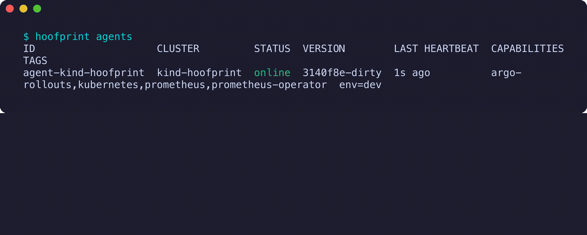
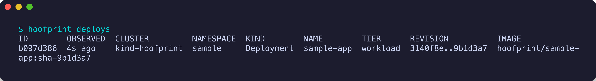
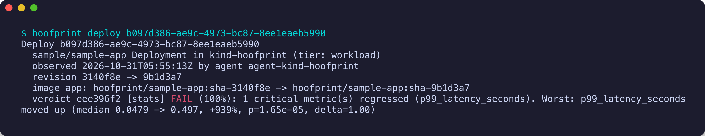
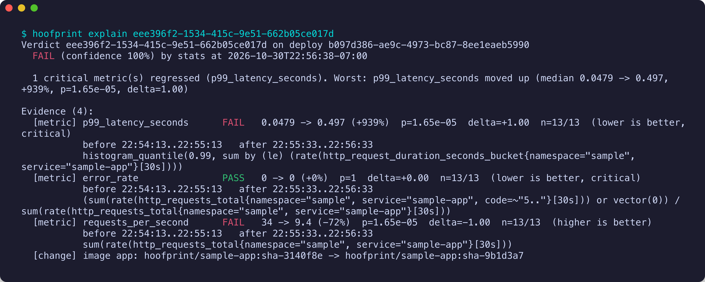
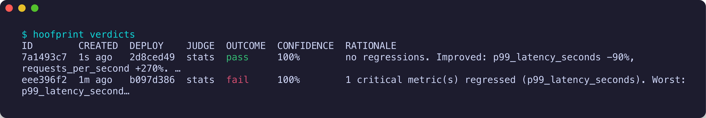

# Hoofprint

**The deploy gate for code nobody read.**

Agents write code faster than humans can review it. Hoofprint sits between merge and production: it watches the canary, reads the diff, correlates logs, traces, and metrics, writes a verdict a human can understand, and rolls back on its own when the change is bad.

Open source. Works on any Kubernetes cluster, whatever deploys to it. Grows into a full delivery platform when you want one.

## The problem

PR volume is up 5–10× on teams using coding agents. Most of that code has had at most a skim from a human. Metrics-threshold canary analysis (Harness CV, Argo Rollouts analysis, Flagger) answers "did p99 go up?" but not "is this change wrong, and why?" When something breaks at 3am, nobody on call understands the diff.

## What Hoofprint does

1. **Watches** every workload change in your cluster via a lightweight agent, whatever deployed it: Argo CD, Flux, Helm, kubectl, GitHub Actions. When Argo Rollouts or Flagger is present, it watches the canary side by side with the baseline.
2. **Gathers evidence**: the git diff, deploy logs, metric deltas vs baseline, trace samples, k8s events.
3. **Judges**: statistical canary comparison first, then an LLM verdict with a written rationale and evidence links.
4. **Acts**: notifies the author with the rationale on every cluster; where a progressive delivery controller exists, pauses promotion or rolls back automatically when confidence is high.

## Positioning

| | Harness CV / Flagger / Argo analysis | Metoro | Hoofprint |
|---|---|---|---|
| Input | metric thresholds | pod-template diff + telemetry | source diff + logs + traces + metrics |
| Output | pass/fail | Healthy / Regression / Inconclusive | verdict + rationale naming the hunk + evidence |
| Action | rollback on threshold | drafts a rollback PR | notify; pause / abort where a rollout controller exists |
| Install | replace or configure your CD | Helm, any CD tool | Helm, any CD tool |
| License | commercial / OSS | commercial, free tier | Apache-2.0 |

## Roadmap in one line

v0: verification gate on any k8s cluster → v1: full pipelines + deploys with the same agent → v2: governance, Harness import parity.

## Demo

An agent-written change adds 300ms of latency to a service. Nobody read the diff. Hoofprint watches the deploy land, compares the window before the change against the window after it through Prometheus (five minutes each by default, one minute in this demo), and writes a verdict that names the metric, the size of the regression, and the commit range.

The deploy is observed the moment the pod template changes, whatever applied it. Scaling is not a deploy; a new image, env or config checksum is.

The verdict: p99 latency up ten times, 99% confidence, commit `3140f8e..9b1d3a7`.

Every verdict is stored with its evidence bundle: the metric comparison per window, the test statistics, the exact query, and the change itself.

The revert ships, and the gate confirms it.

Reproduce it on your laptop with `make kind-up && make demo` (about 10 minutes, see [docs/DEVELOPING.md](docs/DEVELOPING.md)), then `hack/screenshots.sh` to regenerate the images. The screenshots above are from that script, unedited.

## Status

Working today, on any Kubernetes cluster:

- **Agent** (one per cluster, outbound only) detects Argo Rollouts, Argo CD, Flagger, Tekton and Prometheus Operator, and turns every pod-template change into a deploy event.
- **Verification gate**: pre/post comparison through Prometheus for declared metrics, Mann-Whitney U judge with effect size, verdict plus evidence persisted and auditable, CLI to read them.
- **Control plane** with Postgres, a Helm chart for the quickstart, a kind dev loop.

Next: canary vs baseline side by side for Argo Rollouts and Flagger (tier 2), the LLM judge that reads the diff and explains the bug in prose, and actions (PR comment, Slack, pause and abort). See the [roadmap](docs/ROADMAP.md).

## Docs

- [Product spec](docs/SPEC.md)
- [Architecture](docs/ARCHITECTURE.md)
- [Roadmap](docs/ROADMAP.md)
- [Harness migration track](docs/MIGRATION.md)
- [Decision records](docs/adr/)
- [Open questions](docs/OPEN_QUESTIONS.md)
- [Developing](docs/DEVELOPING.md)

## License

Apache-2.0 (proposed). See ADR-0003.
